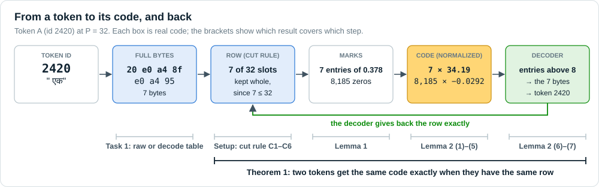
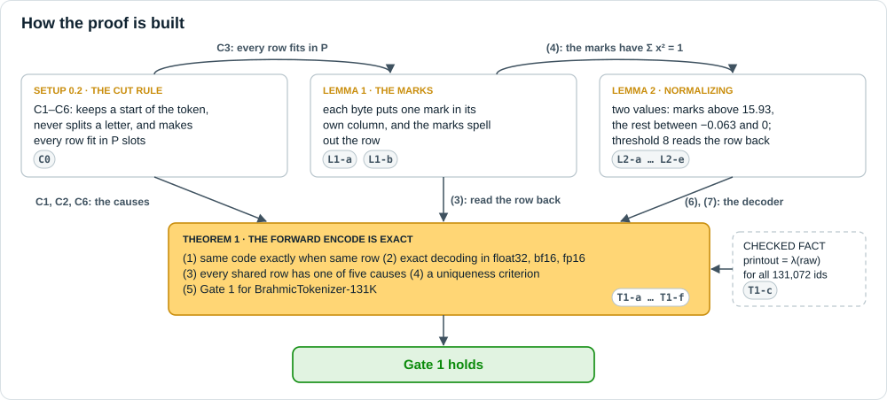
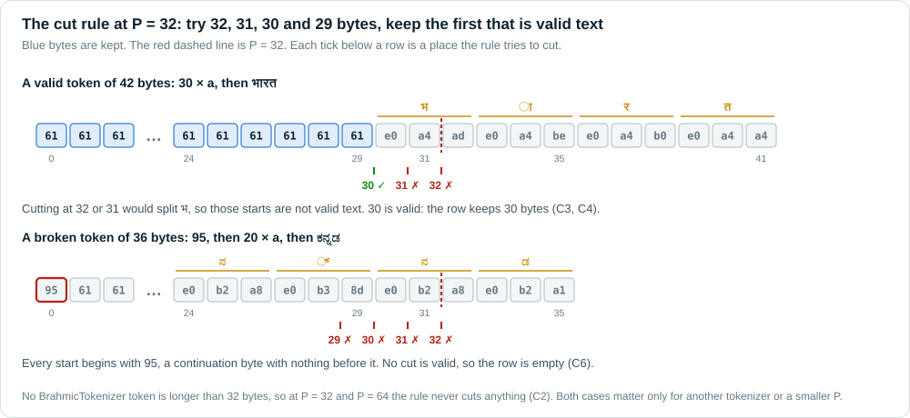
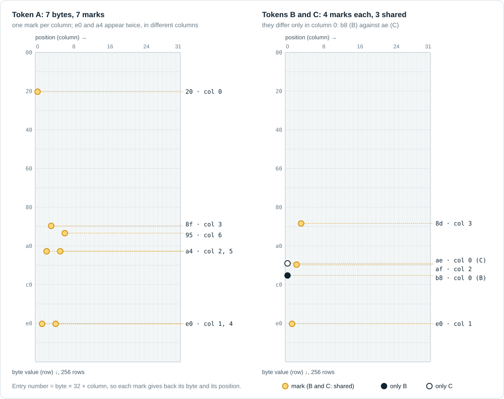
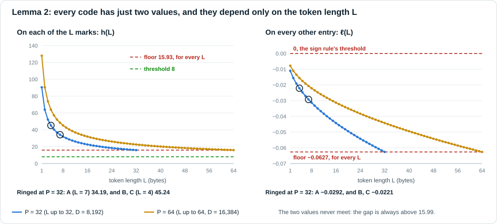
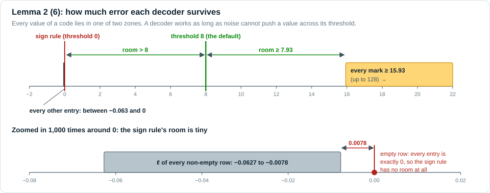
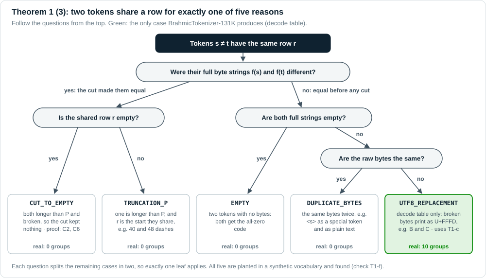
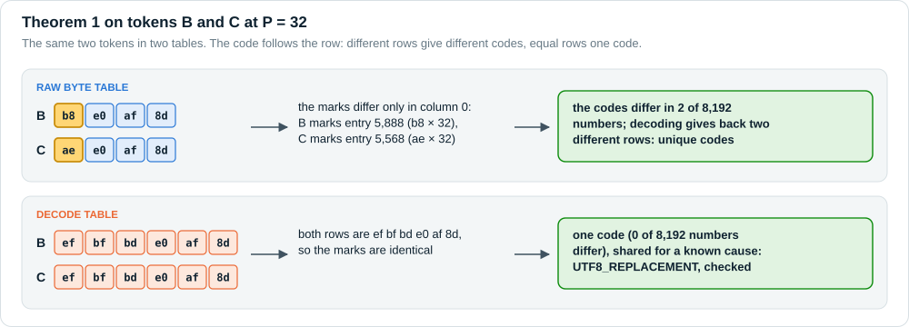

# KE2 week 1: the forward encode is exact

> **The result in one sentence.** The forward encoder of the kronecker-embeddings repository gives
> two tokens the same code **if and only if** the byte table gives them the same row. So every
> shared code has a cause in the table, and with the raw byte table every one of the 131,072
> BrahmicTokenizer-131K tokens has its own code.



*Figure 1. One token's journey. The token's bytes become a row of at most $P$ bytes (the cut rule),
the row becomes marks in a grid (Lemma 1), and normalizing turns the marks into the code (Lemma 2).
A decoder reads the row back from the code (Lemma 2 (6)). That round trip is why Theorem 1 holds.*

**Claim.** The forward encoder of the kronecker-embeddings repository (`kronecker_codec`, with
z-normalization) is **injective** on byte strings of at most $P$ bytes. A family of explicit
decoders recovers the bytes exactly: in float32, after casting the code to bf16 or fp16, and,
with threshold 8, even when every entry is off by up to 7.93. So two token ids share a code
**if and only if** they share a row of the byte table. Every shared row has one of five causes,
each proved and each checked. With the raw byte table, all 131,072 BrahmicTokenizer-131K ids
have different codes, at $P = 32$ and at $P = 64$.

| | |
|---|---|
| Encoder | `kronecker_codec` in `src/kronecker_embeddings/codec.py`, kronecker-embeddings 0.1.1, unchanged. $P$ = `pos_dim`: 32 is the default, 64 uses `pos_dim=64` |
| Cut rule | `utf8_safe_truncate` in `src/kronecker_embeddings/tokenizer_utils.py`, unchanged |
| Tokenizer | BrahmicTokenizer-131K, `tokenizer.json` sha256 `01d968a7…9fff`, commit `7dfcf39`: 131,072 ids, 356 special |
| $D = 256P$ | 8,192 ($P = 32$) and 16,384 ($P = 64$) numbers per code |
| Numerical checks | `src/proof_checks.py` → `results/proof_checks.json`: **37 of 37 pass** (CPU, about 4 minutes) |
| Figures | `src/proof_figures.py` → `docs/figures/`, drawn from the codec's own outputs |
| Tests | `pytest teams/04-ke2/tests -q`: 72 pass |

Paths `src/…`, `results/…`, `tests/…`, `docs/…` are relative to `teams/04-ke2/`. The exception
is `src/kronecker_embeddings/…`, which is in the kronecker-embeddings repository. Each check id
(`C0`, `L1-a`, …) is the `id` field in `results/proof_checks.json`.

## Contents

- [In one page](#in-one-page)
- [The running example](#the-running-example)
- [How the proof is built](#how-the-proof-is-built)
- [0. Setup](#0-setup): notation, the cut rule, the encoder line by line, the two tables
- [1. Lemma 1 (the marks)](#1-lemma-1-the-marks)
- [2. Lemma 2 (normalizing)](#2-lemma-2-normalizing)
- [3. Theorem 1 (the forward encode is exact)](#3-theorem-1-the-forward-encode-is-exact)
- [4. Results for BrahmicTokenizer-131K](#4-results-for-brahmictokenizer-131k)
- [5. Why this proof, and not another](#5-why-this-proof-and-not-another)
- [6. Scope and limits](#6-scope-and-limits)
- [7. Reproduce and trace](#7-reproduce-and-trace)
- [Appendix A. All 37 check runs](#appendix-a-all-37-check-runs)
- [Appendix B. Glossary](#appendix-b-glossary)
- [Credits](#credits)

---

## In one page

KE2 does not learn a separate list of numbers for each token. It computes a fixed **code** from
the token's bytes, and a model layer learns from the codes. That only works if different tokens
get different codes, or, where they cannot, if we know exactly why. This document proves when
codes are equal, and checks every claim with numbers on the real tokenizer.

1. **Setup, the cut rule.** The encoder has room for $P$ bytes. A longer token is cut to a valid
   start of at most $P$ bytes. The rule never changes a token that fits, never splits a letter,
   and never empties valid text. It can empty only a long token that is broken from its first
   byte.
2. **Lemma 1, the marks.** Picture a grid with one row per byte value (256 rows) and one column
   per position ($P$ columns). Each byte of the row puts one mark in its own column, in the row of
   its value. Marks never pile up, and from the marks you can read every byte back.
3. **Lemma 2, normalizing.** The encoder then shifts and stretches all $256P$ numbers. Afterwards
   every mark holds one value above 15.93 and every other entry one value between −0.063 and 0.
   A decoder that keeps the entries above 8 reads the row back, even when every number is off by
   up to 7.93, and also after rounding to the 16-bit formats a model trains in.
4. **Theorem 1.** Because a decoder exists, two tokens get the same code **exactly** when they
   have the same row. Rows can be equal in only five ways, and each is proved and checked.
5. **Gate 1.** With the raw byte table all 131,072 rows differ, so all 131,072 codes differ. With
   the repository's current decode table, 1,151 tokens share 10 codes, all because broken bytes
   print as U+FFFD, and each group's cause is checked.

| result | in plain words | section | checked by | outcome |
|---|---|---|---|---|
| Cut rule C1–C6 | the cut keeps a valid start, never splits a letter, empties only broken long tokens | [0.2](#02-the-cut-rule-and-its-properties) | C0 | 0 violations on 10,004 strings per $P$ |
| Lemma 1 (1)–(4) | one mark per byte, in its own column; the marks spell the row | [1](#1-lemma-1-the-marks) | L1-a, L1-b, T1-d | exact on all 524,288 table rows |
| Lemma 2 (1)–(7) | two values; marks ≥ 15.93, the rest in (−0.063, 0); threshold 8 survives errors up to 7.93 | [2](#2-lemma-2-normalizing) | L2-a … L2-e | 0 failures, also in bf16 and fp16 |
| Theorem 1 (1)–(4) | same code exactly when same row; five possible causes | [3](#3-theorem-1-the-forward-encode-is-exact) | T1-a … T1-f | all five causes found and checked |
| Theorem 1 (5), Gate 1 | raw table: 131,072 different codes; decode table: 10 groups, all U+FFFD | [4](#4-results-for-brahmictokenizer-131k) | T1-b, T1-e, `results/collisions.csv` | holds at $P = 32$ and $P = 64$ |

---

## The running example

Three real tokens appear in every section, so each abstract statement has a concrete case.

| | token id | where it comes from | raw bytes (raw table row) | printout bytes (decode table row) |
|---|---|---|---|---|
| **A** | 2420 | `" एक"` (Hindi "one") in भारत एक देश है, split 66526 · **2420** · 13092 · 732 | `20 e0 a4 8f e0 a4 95` (7 bytes) | the same 7 bytes |
| **B** | 39329 | the end of மிஸ் ("miss"), split 4475 · 19844 · **39329** | `b8 e0 af 8d` (4 bytes) | `ef bf bd e0 af 8d` (6 bytes) |
| **C** | 74642 | the end of ம்ம் ("hmm"), split 4475 · 15336 · **74642** | `ae e0 af 8d` (4 bytes) | `ef bf bd e0 af 8d` (6 bytes) |

- **A** is an ordinary token: a space and two complete Devanagari letters.
- **B** and **C** are pieces. The Tamil letter ஸ is the 3 bytes `e0 ae b8`, and the tokenizer
  split மிஸ் inside it, so B starts with the stray last byte `b8`, followed by the sign ் (`e0 af 8d`).
  C is the same with the letter ம (`e0 ae ae`).
- B and C differ only in their first byte. Neither first byte is a character on its own, so both
  **print** as U+FFFD followed by ். The raw table keeps them apart; the decode table merges them.

What the proof says about them, in short:

| | A | B and C |
|---|---|---|
| Cut rule (0.2) | 7 ≤ 32, kept whole | 4 and 6 ≤ 32, kept whole |
| Lemma 1 | 7 marks in 7 different columns | 4 marks each, 3 shared; only column 0 differs |
| Lemma 2 | 7 entries of 34.19, 8,185 of −0.0292 ($P = 32$) | raw: 4 of 45.24, the rest −0.0221 |
| Theorem 1 | unique code in both tables | raw: different codes; decode: one code, cause `UTF8_REPLACEMENT` |

---

## How the proof is built



*Figure 2. The cut rule makes every row fit in $P$ slots, which Lemma 1 needs. Lemma 1 gives the
marks, and Lemma 2 shows they survive normalizing, so a decoder exists. The decoder proves
Theorem 1 (1) and (2). The cut rule's properties, plus one checked fact about the printout,
prove the five causes. Gate 1 follows.*

**Why a proof is needed at all.** Task 2 counts the tokens whose *rows* are equal. That says
something about *codes* only if the encoder never merges two different rows on its own. It
could, in principle, in three places:

1. **Two bytes could land on the same grid entry**, so the marks of different rows could look
   alike. Lemma 1 rules this out.
2. **Normalizing uses a shift and a stretch that depend on the row itself.** Two different mark
   patterns could, in principle, end up as the same numbers. Lemma 2 rules this out.
3. **Rounding** in float32, or in bf16 and fp16 during training, could blur the values. Lemma 2 (7)
   rules this out.

The cut rule *can* merge rows, by cutting two long tokens to the same start. Section 0.2 and
Theorem 1 (3) describe exactly when.

**How each result is written.** In plain words → why it is needed → the statement → the proof,
step by step, with the reason for each step → a worked example on tokens A, B and C → the
numerical checks that confirm it on real data.

---

## 0. Setup

### 0.1 Notation

Positions are 0-based, as in the code. Two symbols look alike: $\varepsilon$ (curly) is the
**empty row**, and $\epsilon = 10^{-6}$ is the small constant the encoder adds before dividing.

| symbol | meaning | in the code |
|---|---|---|
| $\Sigma=\lbrace 0,\dots,255\rbrace$ | byte values (`char_dim` = 256) | `codec.py:31` |
| $\Sigma^{\le P}$ | byte strings $b=(b_0,\dots,b_{L-1})$ with $0\le L\le P$ (rows) | `codec.py:43-47` |
| $\iota(v,p)=vP+p$ | address of byte $v$ at position $p$ | `codec.py:85`, `lin_idx = bytes_long * pos_dim + pos` |
| $c_v\otimes e_p$ | unit vector at address $\iota(v,p)$ ($c_v\in\mathbb R^{256}$, $e_p\in\mathbb R^{P}$ one-hot) | same line |
| $\kappa_P(b)=L^{-1/2}\sum_{p<L}c_{b_p}\otimes e_p$, $\ \kappa_P(\varepsilon)=0$ | the marks | `codec.py:88-99` |
| $\mu,\ \sigma,\ \epsilon$ | mean; **sample** standard deviation (divides by $D-1$); $10^{-6}$ | `codec.py:101-104` |
| $z(x)=(x-\mu\mathbf 1)/(\sigma+\epsilon)$, $\ e_P=z\circ\kappa_P$ | normalizing; forward encode of a row | `kronecker_codec(..., z_normalize=True)` |
| $S(b)$ | support: the set of marked addresses | |
| $\mathcal D_\theta$ | decoder: addresses with value $>\theta$ → bytes | `src/decode_ref.py: decode_codes(E, P, threshold)` |
| $\tau_P$ | the cut rule | `tokenizer_utils.py:31-45` |
| $f_{\rm raw}(t)$, $f_{\rm dec}(t)$ | full bytes of token $t$: true bytes from the vocab piece; bytes of `tokenizer.decode([t])` | `src/decode_ref.py: raw_byte_table`, `src/ke2_common.py: decode_full_bytes` |
| $\lambda(y)$ | `y.decode("utf-8", "replace").encode("utf-8")`: broken sequences become U+FFFD | `src/synthetic.py: lam` |
| $T_P(t)=\tau_P(f(t))$, $\ E_P(t)=e_P(T_P(t))$ | row and code of token $t$ | `src/build_tables.py`, `KroneckerEmbedding` |

### 0.2 The cut rule and its properties

> **In plain words.** The encoder has room for $P$ bytes per token. A longer token is cut: the
> repository keeps the longest start of at most $P$ bytes that is valid text, trying $P$, $P-1$,
> $P-2$ and $P-3$ bytes. If none of the four is valid, it keeps nothing.
>
> **Why it is needed.** The cut is the one step before the encoder that can make two different
> tokens look alike. To account for every collision, we need to know exactly what it can and
> cannot do.

$\tau_P$ is `utf8_safe_truncate(·, P)`. If $|r|\le P$ it returns $r$. Otherwise it returns
$r[0{:}c]$ for the first $c\in(P,P-1,P-2,P-3)$ for which $r[0{:}c]$ is valid UTF-8, and the empty
string if there is none. For every byte string $r$ and $P\ge 4$:

| | property | in plain words |
|---|---|---|
| C1 | $\tau_P(r)$ is a prefix of $r$. | the result is always a start of the token |
| C2 | If $\lvert r\rvert\le P$, then $\tau_P(r)=r$. | a token that fits is never touched |
| C3 | $\lvert\tau_P(r)\rvert\le P$. If $\lvert r\rvert>P$, then $\tau_P(r)$ is valid UTF-8 and is empty or has $P-3$ to $P$ bytes. | every row fits; a cut row is valid text |
| C4 | If $r$ is valid UTF-8, then $\tau_P(r)$ is valid UTF-8, and it is empty only if $r$ is. | a letter is never split, and valid text is never emptied |
| C5 | $\tau_P(\tau_P(r))=\tau_P(r)$. | cutting twice changes nothing |
| C6 | If $\lvert r\rvert>P$ and $\tau_P(r)$ is empty, then $r$ is not valid UTF-8. | only a broken long token can be emptied |

**Proof.** C1, C2, C3 and C5 can be read off the rule: it returns all of $r$, a valid prefix of
length $P-3$ to $P$, or the empty string, and a result of length at most $P$ is returned unchanged.

For C4, let $r$ be valid with $|r|>P$; shorter $r$ is covered by C2. A prefix of a valid string is
valid exactly when the cut falls between letters, that is, when $r[c]$ is not a continuation byte
(`80`–`bf`). A letter is a lead byte followed by at most 3 continuation bytes.
- If $r[P]$ is not a continuation byte, $c = P$ works.
- Otherwise the letter containing $r[P]$ starts at some $q$ with $P-3\le q<P$, and $c=q$ works.

So some $c\in\lbrace P,\dots,P-3\rbrace$ gives a valid, non-empty prefix. C6 is C4 read backwards. $\square$



*Figure 3. Top: a valid token whose 33rd byte falls inside the letter भ. Cuts at 32 and 31 would
split it, so the rule keeps 30 bytes (C3, C4). Bottom: a token that starts with the stray
continuation byte `95`. Every start is broken, so the rule keeps nothing (C6).*

**Where the rule empties a token.** A token longer than $P$ that is not valid UTF-8 may have no
valid prefix among the four. The rule then returns nothing, and the token gets the all-zero code.
Example at $P=32$, a 36-byte token:

```
95 | 61 ×20 | e0 b2 95 | e0 b2 a8 | e0 b3 8d | e0 b2 a8 | e0 b2 a1
```

This is a stray continuation byte, twenty `a`, then the five Kannada letters of ಕನ್ನಡ. Every prefix
starts with `95`, so none is valid UTF-8. With the decode table this cannot happen, because by C4
its rows are always valid UTF-8. With the raw table it could, but **not for BrahmicTokenizer at
$P \ge 32$**: its longest token has 32 bytes, so by C2 the rule never cuts anything. It matters for
a smaller $P$ or another tokenizer, such as G3's v0. Theorem 1 names this case `CUT_TO_EMPTY`.

**For the running example.** A, B and C have 7, 4 and 4 raw bytes, and B and C print as 6 bytes.
All are at most 32, so by C2 every one of them reaches the encoder unchanged.

| id | check | scope | result |
|---|---|---|---|
| C0 | C1–C6 on synthetic strings: random bytes (half of them continuation bytes) and valid UTF-8 mixing six scripts with emoji and punctuation, up to 320 bytes; plus the 36-byte example | 10,004 strings per $P$; at $P=32$, 8,201 are longer than $P$, 4,063 of them valid, and 4,138 get cut to nothing; at $P=64$: 6,552 / 3,217 / 3,335 | 0 violations. The example gives 0 bytes at $P=32$ and stays whole (36 bytes) at $P=64$ |

### 0.3 The encoder, line by line

This is the code the proof is about, from `src/kronecker_embeddings/codec.py` (unchanged), with the
symbol each line computes:

```python
lin_idx = bytes_long * pos_dim + pos                         # line 85    address ι(v, p) = vP + p
valid = pos < lens_long.unsqueeze(1)                         # line 88    only positions p < L count
scales = torch.rsqrt(lens_long.clamp_min(1).to(torch.float32))   # line 92    each mark is 1/√L
src = valid.to(torch.float32) * scales.unsqueeze(1)          # line 93
out = torch.zeros((B, D), device=device, dtype=torch.float32)    # line 98    D = 256P zeros
out.scatter_add_(dim=1, index=lin_idx, src=src)              # line 99    κ_P(b): put the marks in
mean = out.mean(dim=-1, keepdim=True)                        # line 102   μ
std = (out - mean).std(dim=-1, keepdim=True) + eps           # line 103   σ + ϵ (sample std, D − 1)
out = (out - mean) / std                                     # line 104   z(x) = (x − μ) / (σ + ϵ)
```

Three details matter for the proof:
- **`scatter_add_` adds.** If two marks shared an address, they would add up. Lemma 1 (2) shows
  they never do, so every mark is exactly $1/\sqrt L$.
- **Line 70 rejects input that is not exactly $P$ positions wide**, and padding positions $p \ge L$ get weight 0 (line 88).
  So only the first $L \le P$ bytes are encoded, which is why rows must fit (C3).
- **`std` divides by $D-1$** (PyTorch's default). The closed forms in Lemma 2 use exactly this.

### 0.4 The two tables

Both tables have one row per token id, stored as `byte_buffer` ($V \times P$ bytes) and
`length_buffer` ($V$ lengths), the repository's layout. They differ only in where the bytes come
from:

| table | full bytes $f(t)$ | for token B | role |
|---|---|---|---|
| **decode** | $f_{\rm dec}(t)$: the bytes of `tokenizer.decode([t])`, the repository's `token_id_to_bytes` | `ef bf bd e0 af 8d` | what the repository feeds the encoder today; it has the known issue |
| **raw** | $f_{\rm raw}(t) = \beta^{-1}(\text{piece}(t))$: the vocab piece `¸à¯į` turned back into bytes | `b8 e0 af 8d` | the fix |

Here $\beta$ is byte-level BPE's byte map: each of the 256 bytes is written as one printable
character, and $\beta^{-1}$ undoes it (`¸` → `b8`, `à` → `e0`, `¯` → `af`, `į` → `8d`). Special
tokens use their literal text in both tables. Then $T_P(t) = \tau_P(f(t))$ in both.

The two are linked by one fact, **checked for all 131,072 ids (T1-c)** rather than proved, since it
is a property of the tokenizer library:

$$
f_{\rm dec}(t) \;=\; \lambda\big(f_{\rm raw}(t)\big),
$$

where $\lambda$ reads the bytes as UTF-8, replaces every broken sequence with U+FFFD (`ef bf bd`),
and turns the result back into bytes. $\lambda$ changes nothing on valid UTF-8. On broken input it
loses information: $\lambda(\texttt{b8 e0 af 8d}) = \lambda(\texttt{ae e0 af 8d}) = \texttt{ef bf bd e0 af 8d}$.
That is the known issue in one line.

### 0.5 Worked example: token A

Token 2420, `" एक"`, at $P=32$, $D=8192$:
- Bytes `20 e0 a4 8f e0 a4 95`, so $L=7$.
- Marks at $\lbrace 1024, 7169, 5250, 4579, 7172, 5253, 4774\rbrace$, each $1/\sqrt7=0.37796$.
- After normalizing: $34.1896$ on the marks, $-0.0292398$ on the other 8,185 entries.
- Entries above any threshold in $[0, 15.93)$ are exactly the marks, and byte $=\lfloor i/32\rfloor$,
  position $=i \bmod 32$ gives back `20 e0 a4 8f e0 a4 95`.

Sections 1 to 3 explain each of these lines.

---

## 1. Lemma 1 (the marks)

> **In plain words.** For a row of $L$ bytes, the grid holds exactly $L$ marks, one in each of
> the columns $0$ to $L-1$, all with the same value $1/\sqrt L$. From the marks you can read every
> byte back. So two different rows always give different marks.
>
> **Why it is needed.** The encoder adds marks into one long list (`scatter_add_`). If two marks
> could share an entry they would add up, and different rows could produce the same list.

**Statement.** Let $b\in\Sigma^{\le P}$ with $L=|b|\ge 1$.

1. $\kappa_P(b)$ has exactly $L$ nonzero entries, each $L^{-1/2}$, at $S(b)=\lbrace b_pP+p : 0\le p<L\rbrace$.
2. Column $p$, the addresses $\lbrace vP+p : v\in\Sigma\rbrace$, holds exactly one element of $S(b)$ if $p<L$, and none if $p\ge L$.
3. $b$ can be read back: $L=|S(b)|$, and $b_p=\lfloor s/P\rfloor$ for the unique $s\in S(b)$ with $s \bmod P = p$.
4. For non-empty $a,b\in\Sigma^{\le P}$: $\langle\kappa_P(a),\kappa_P(b)\rangle=m(a,b)/\sqrt{|a|\,|b|}$, where
   $m(a,b)$ is the number of positions $p<\min(|a|,|b|)$ with $a_p=b_p$. In particular $\lVert\kappa_P(b)\rVert=1$.

Hence $\kappa_P(a)=\kappa_P(b)\Rightarrow a=b$ on $\Sigma^{\le P}$. The empty row maps to $0$, the
only image with no nonzero entry.



*Figure 4. The whole grid at $P = 32$: 256 rows (byte values) by 32 columns (positions), 8,192
entries. Left: token A lights 7 entries, one per column. The byte `e0` appears twice, at positions
1 and 4, and lands in two different columns. Right: B and C share three marks and differ only in
column 0.*

**Proof.**

| step | claim | reason |
|---|---|---|
| 1 | Every address $i<256P$ is $i=qP+r$ for exactly one $0\le r<P$ and $0\le q\le 255$, so $\iota$ is a bijection $\Sigma\times\lbrace 0,\dots,P-1\rbrace\to\lbrace 0,\dots,D-1\rbrace$. | division with remainder |
| 2 | The mark for position $p$ sits at $\iota(b_p,p)$, whose remainder is $p$. Different positions give different addresses, even when a byte repeats. | step 1, and $p<L\le P$ |
| 3 | $\kappa_P(b)$ is $L^{-1/2}$ times a sum of $L$ unit vectors at distinct addresses: nothing adds twice, nothing cancels. This is (1); grouping the addresses by remainder gives (2). | step 2 |
| 4 | Each mark $s$ gives position $s \bmod P$ and byte $\lfloor s/P\rfloor$. This is (3), and with it injectivity. | step 1 run backwards |
| 5 | $\langle c_v\otimes e_p, c_w\otimes e_q\rangle=[v=w]\,[p=q]$, so the double sum keeps only the positions where both strings have the same byte. This is (4). $\square$ | the Kronecker product of unit vectors |

**Worked example: token A at $P = 32$.**

| position $p$ | byte (hex) | byte $v$ | address $v \cdot 32 + p$ | read back: $\lfloor s/32 \rfloor$, $s \bmod 32$ |
|---|---|---|---|---|
| 0 | `20` | 32 | 1,024 | 32, 0 |
| 1 | `e0` | 224 | 7,169 | 224, 1 |
| 2 | `a4` | 164 | 5,250 | 164, 2 |
| 3 | `8f` | 143 | 4,579 | 143, 3 |
| 4 | `e0` | 224 | 7,172 | 224, 4 |
| 5 | `a4` | 164 | 5,253 | 164, 5 |
| 6 | `95` | 149 | 4,774 | 149, 6 |

Seven marks at seven different addresses, each $1/\sqrt 7 = 0.37796$. The repeated bytes `e0` and
`a4` land 3 apart, in different columns. By (4), $\lVert\kappa\rVert^2 = 7 \cdot (1/\sqrt7)^2 = 1$.

**Worked example: tokens B and C.** B marks addresses 5,888 (`b8` at 0), 7,169, 5,602 and 4,515.
C marks 5,568 (`ae` at 0), 7,169, 5,602 and 4,515. They share 3 of 4 marks, so by (4)
$\langle\kappa(B),\kappa(C)\rangle = 3/\sqrt{4\cdot 4} = 0.75$: close, but not equal.

**Remark: why the position matters.** Without the column, a row would be a bag of bytes, and `ab`
and `ba` would get the same marks. With it, `ab` marks $97P+0$ and $98P+1$, while `ba` marks
$98P+0$ and $97P+1$.

**Remark: why rows must fit in $P$.** The bound $L\le P$ is what makes step 2 work. A byte $v$ at
position $P$ would have address $vP+P=(v+1)P+0$, the same as byte $v+1$ at position 0, so marks
could collide. The codec takes exactly $P$ positions per row (`codec.py:70`), and the cut rule
guarantees every row fits (C3).

**Remark: the paper's assumption.** The paper assumes the $(b_p, p)$ pairs are distinct. In this
codec that holds by construction, because the positions are distinct.

| id | check | scope | result |
|---|---|---|---|
| L1-a | the nonzero pattern of `kronecker_codec(z_normalize=False)` equals $S(b)$, and every nonzero equals `rsqrt(L)` exactly | every token of all 4 tables (4 × 131,072) | 0 rows with wrong support, 0 with a wrong value |
| L1-b | $\langle\kappa(a),\kappa(b)\rangle$ against $m(a,b)/\sqrt{\lvert a\rvert\lvert b\rvert}$ | 200,000 token pairs per $P$; half share length and first byte, and 52,314 have $m\ge2$ | max abs error $1.34\times10^{-7}$ |

---

## 2. Lemma 2 (normalizing)

> **In plain words.** Normalizing turns every mark into the same high number and every other
> entry into the same slightly negative number. For every token length, the high number is above
> 15.93 and the low one is between −0.063 and 0. So any cut-off in between finds the marks.
> A cut-off of 8 is the safest: it still works if every number is off by almost 8, and after
> rounding to the 16-bit formats a model trains in.
>
> **Why it is needed.** Normalizing subtracts the row's own mean and divides by the row's own
> spread, so the shift and the stretch differ from row to row. Lemma 1 says the marks differ;
> this lemma says the normalized numbers still show where the marks are.

**Statement.** Let $b\in\Sigma^{\le P}$, $L=|b|$, $x=\kappa_P(b)$, $D=256P$, $\sigma_L=\sqrt{(1-L/D)/(D-1)}$.

1. **Mean and spread.** If $L\ge1$: $\mu(x)=\sqrt L/D$ and $\sigma(x)=\sigma_L$. Both depend only on $L$.
2. **Two values.** $e_P(b)$ equals $h_L=\dfrac{L^{-1/2}-\sqrt L/D}{\sigma_L+\epsilon}$ on $S(b)$ and $\ell_L=\dfrac{-\sqrt L/D}{\sigma_L+\epsilon}$ elsewhere. If $L=0$: $e_P(b)=0$.
3. **Signs.** $h_L>0>\ell_L$.
4. **Gap.** $h_L-\ell_L=\dfrac{1}{\sqrt L\,(\sigma_L+\epsilon)}\ \ge\ \dfrac{\sqrt{(D-1)/P}}{1+\epsilon\sqrt{D-1}}$, which is above 15.99 for $P\in\lbrace 32,64\rbrace$.
5. **Bounds for every length.** For all $1\le L\le P$: $h_L\ \ge\ \sqrt{\tfrac{D-1}{P}}\,\dfrac{1-P/D}{1+\epsilon\sqrt D}$ (above 15.93), and $-\dfrac{\sqrt P/D}{\sigma_P}\le\ell_L<0$ (above $-0.0627$).
6. **Decoders and their margins.** For $\theta\ge0$, let $\mathcal D_\theta(y)$ read bytes, as in Lemma 1(3), from $\lbrace i : y_i>\theta\rbrace$, and reject $y$ if that set is not one address in each of positions $0,\dots,L-1$.
   - For every $\theta\in[0,\,15.93)$, in particular $\theta=0$ and $\theta=8$: $\mathcal D_\theta(e_P(b))=b$ for every row, the empty one included.
   - If every entry of $y$ is within $\delta_\theta(b)$ of $e_P(b)$, then $\mathcal D_\theta(y)=b$. Here $\delta_\theta(b)=\min(h_L-\theta,\ \theta-\ell_L)$ for $L\ge1$, and $\delta_\theta(\varepsilon)=\theta$.
   - For $\theta=8$ the margin is at least **7.93 for every row**. For the sign rule $\theta=0$ it is $|\ell_L|\ge|\ell_1|$ (0.0110 at $P=32$, 0.0078 at $P=64$) for non-empty rows, and **0** for the empty row.
7. **Floating point.**
   - **(a)** The code computed in float32 decodes exactly with $\mathcal D_0$ and $\mathcal D_8$.
   - **(b)** Casting the code to bf16 or fp16, which `KroneckerEmbedding` does when the model runs in that dtype (`embedding.py:203`), keeps exactly two values with the same signs and $h\ge15.87>8$. So $\mathcal D_0$ and $\mathcal D_8$ still decode exactly.

The two values in one picture, for every length:



*Figure 5. Left: the value on each mark falls as the token gets longer, because the same total
weight is shared by more marks. It never drops below 15.93. Right: the value everywhere else
stays negative and above −0.0627. The rings mark tokens A and B, C.*

The same numbers in a table (from the closed forms; check L2-a confirms the codec matches them to
within $2\times10^{-7}$ at every length):

| $L$ | $h_L$, $P=32$ | $\ell_L$, $P=32$ | $h_L$, $P=64$ | $\ell_L$, $P=64$ | example |
|---|---|---|---|---|---|
| 0 | 0 | 0 | 0 | 0 | the empty row: every entry is exactly 0 |
| 1 | 90.4904 | −0.01105 | 127.9758 | −0.00781 | a single byte |
| 4 | 45.2369 | −0.02210 | 63.9820 | −0.01562 | B and C (raw) |
| 6 | 36.9313 | −0.02707 | 52.2379 | −0.01914 | B and C (decode) |
| 7 | 34.1896 | −0.02924 | 48.3614 | −0.02067 | A |
| 8 | 31.9795 | −0.03126 | 45.2366 | −0.02210 | |
| 16 | 22.6019 | −0.04423 | 31.9793 | −0.03126 | |
| 32 | **15.9663** | **−0.06261** | 22.6017 | −0.04423 | the longest BrahmicTokenizer token |
| 64 | | | **15.9662** | **−0.06261** | only possible at $P=64$ |
| bound (5) | ≥ 15.9351 | ≥ −0.0626186 | ≥ 15.9350 | ≥ −0.0626205 | holds for every $L$ |

How much error each decoder survives (part 6):



*Figure 6. Threshold 8 sits in the middle of a gap at least 15.9 wide, so it survives an error of
up to 7.93 in every number. The sign rule sits right at the edge of the low zone. Its room is
at most 0.0627, as little as 0.0078, and none at all for the empty row, whose entries are exactly 0.*

**Proof.**
1. $\sum_i x_i=L\cdot L^{-1/2}=\sqrt L$, so $\mu=\sqrt L/D$. By Lemma 1(4), $\sum_i x_i^2=1$, so
   $\sum_i(x_i-\mu)^2=\sum x_i^2-2\mu\sum x_i+D\mu^2=1-2L/D+L/D=1-L/D$. Divide by $D-1$. This is (1).
2. $z$ applies one map $t\mapsto(t-\mu)/(\sigma+\epsilon)$ to every entry, so the $L$ entries equal to
   $L^{-1/2}$ become $h_L$ and the zeros become $\ell_L$. For $L=0$: $x=0$, $\mu=\sigma=0$, $z=0/\epsilon=0$.
   This is (2).
3. $h_L>0\iff L^{-1/2}>\sqrt L/D\iff D>L$, true since $L\le P<256P$. And $\ell_L<0$ because
   $\mu>0$. This is (3).
4. $h_L-\ell_L=L^{-1/2}/(\sigma_L+\epsilon)$. Use $L\le P$ and $\sigma_L\le 1/\sqrt{D-1}$. This is (4).
5. $L^{-1/2}(1-L/D)$ decreases in $L$, so it is at least $P^{-1/2}(1-P/D)$. Also
   $\sigma_L+\epsilon\le(1+\epsilon\sqrt D)/\sqrt{D-1}$. Dividing gives the bound on $h_L$. For
   $\ell_L$: $\sqrt L\le\sqrt P$ and $\sigma_L\ge\sigma_P$, because $\sigma_L$ decreases in $L$.
   This is (5).
6. Let $|y_i-e_P(b)_i|<\delta_\theta(b)$ for all $i$.
   - On a mark, $y_i>h_L-\delta\ge\theta$. Off the marks, $y_i<\ell_L+\delta\le\theta$. So
     $\lbrace i : y_i>\theta\rbrace=S(b)$ and Lemma 1(3) returns $b$.
   - For the empty row $e=0$, so $y_i<\theta$ everywhere: no marks, and the result is $\varepsilon$.
   - $\delta=0$ (no noise) gives exactness for every $\theta\in[0,\min_L h_L)$. Note $\theta<0$
     would fail on the empty row.
   - For $\theta=8$: $h_L-8\ge7.93$ by (5), and $8-\ell_L>8$.

   This is (6).
7. (a) In float32 the computed mean $\hat\mu$ is a sum of positive numbers divided by $D$, so it is
   positive: each empty entry $-\hat\mu/(\hat\sigma+\epsilon)$ is negative. A mark is at least
   $1/\sqrt{64}=0.125$, far above $\hat\mu\le 7\times10^{-4}$, so the computed mark minus $\hat\mu$
   is positive (subtracting a smaller positive float gives a positive float), and dividing by
   $\hat\sigma+\epsilon>0$ keeps the sign. So $\mathcal D_0$ is exact. Each operation has relative
   error at most $2^{-24}$, except the $D$-term sum inside $\hat\sigma$, which has at most about
   $D\cdot2^{-24}\le10^{-3}$. So the computed $h$ is above $15.93(1-2\cdot10^{-3})>15.8>8$, and
   $\mathcal D_8$ is exact.

   (b) Rounding to nearest is monotone and maps equal numbers to equal numbers. For values in the
   normal range its relative error is at most $2^{-8}$ (bf16) or $2^{-11}$ (fp16). Every $h_L$ lies
   in $[15.935,128]$ and every $|\ell_L|$ in $[0.0078,0.0627]$, both normal in both formats (fp16's
   smallest normal is $6.1\times10^{-5}$). So the rounded $h\ge15.935(1-2^{-8})>15.87$ and the
   rounded $\ell<0$. $\square$

**Worked example: token A ($L = 7$) at $P = 32$.**

| quantity | formula | value | PyTorch float32 |
|---|---|---|---|
| each mark before normalizing | $1/\sqrt 7$ | 0.37796447 | 0.37796447 |
| mean $\mu$ | $\sqrt 7 / 8192$ | 0.00032297 | |
| spread $\sigma_7$ | $\sqrt{(1 - 7/8192)/8191}$ | 0.0110445 | |
| value on the 7 marks, $h_7$ | $(0.37796447 - 0.00032297)/(0.0110445 + 10^{-6})$ | **34.1896** | 34.18963623 |
| value on the other 8,185 entries, $\ell_7$ | $-0.00032297/(0.0110445 + 10^{-6})$ | **−0.0292398** | −0.02923976 |
| gap $h_7 - \ell_7$ | | 34.2189 | |
| room for error with threshold 8 / with the sign rule | $\min(h_7 - 8,\ 8 - \ell_7)$ / $\lvert\ell_7\rvert$ | 8.0292 / 0.0292 | |

So the decoder with threshold 8 finds exactly the 7 marks of figure 4, and Lemma 1 (3) reads
`20 e0 a4 8f e0 a4 95` back from them.

**Worked example: B and C.** Raw rows ($L = 4$): every mark is 45.2369 and every other entry
−0.0221 (PyTorch: 45.23692322 and −0.02209913). Their shared decode row ($L = 6$): 36.9313 and
−0.0271. In both tables the two values depend only on the length, so B and C get the same two
numbers. What separates their raw codes is *where* the marks are, which is Lemma 1.

| id | check | scope | result |
|---|---|---|---|
| L2-a | codec against the closed forms $\mu,\sigma_L,h_L,\ell_L$; $h_L>0>\ell_L$; $e(\varepsilon)=0$ | every $L=0..P$, $P\in\lbrace 32,64\rbrace$ | max relative error $\mu$ $6.9\times10^{-8}$, $\sigma$ $6.9\times10^{-8}$, $h$ $9.6\times10^{-8}$, $\ell$ $1.9\times10^{-7}$; the empty row gives exactly 0 |
| L2-b | every token code is exactly two-valued, matches $h_L,\ell_L$, and $\lbrace E>0\rbrace=S$ | every token of all 4 tables | 0 rows fail. Smallest positive entry 15.966 ($P=32$) and 22.602 ($P=64$, where the longest token has 32 bytes); entry closest to 0: −0.01105 / −0.00781 |
| L2-c | bounds (4)–(5) for every $L$, from codec outputs | every $L=1..P$, both $P$ | $P=32$: $\min h=15.9663\ge15.9351$; $\ell\in[-0.0626129,-0.0110475]$, inside $[-0.0626186, 0)$; $\min$ gap $=16.0289\ge15.9976$. $P=64$: $15.9662\ge15.9350$; $[-0.0626125,-0.0078115]$; gap $16.0288\ge15.9975$ |
| L2-d | $\mathcal D_0$ and $\mathcal D_8$ on float32 codes and on codes cast to bf16 and fp16 | every token of all 4 tables, 6 decoder runs each | 0 mismatches. After the cast: $\min h$ 15.9375 (bf16) and 15.9688 (fp16) at $P=32$; 22.625 / 22.6094 at $P=64$; $\ell$ stays negative |
| L2-e | noise on real codes: uniform in $(-a, a)$ per entry | 2,000 raw-table codes per $P$ | threshold 8 at $a=7.9$: **0 errors**; at $a=0.05$: 0. Sign rule at $a=0.9\lvert\ell_1\rvert$: 0, but at $a=0.05$: **1,990** errors ($P=32$) and **2,000** ($P=64$) |

`tests/test_ke2_proof.py` also checks that noisy codes of the empty row fool the sign rule but
not threshold 8: this is the $\delta_0(\varepsilon)=0$ case of (6).

---

## 3. Theorem 1 (the forward encode is exact)

> **In plain words.** Two tokens get the same code exactly when their rows are the same bytes.
> So every shared code comes from the table, never from the encoder. And rows can be equal in
> only five ways: a long token was cut at $P$, a broken long token was cut to nothing, both
> tokens are empty, the bytes really are the same, or (decode table only) broken bytes were
> printed as U+FFFD.
>
> **Why it is needed.** This is what lets Task 2 count collisions on rows instead of on codes,
> and it is the forward encode proof that Gate 1 asks for.

**Statement.** Let $T_P$ be a byte table (raw or decode), so $T_P(t)=\tau_P(f(t))$, and
$E_P(t)=e_P(T_P(t))$.

1. **Exactness.** $E_P(s)=E_P(t)\iff T_P(s)=T_P(t)$. The encoder adds no collisions of its own.
2. **Decoding.** $\mathcal D_0$ and $\mathcal D_8$ recover $T_P(t)$ from $E_P(t)$ exactly: in float32
   and after a bf16 or fp16 cast. $\mathcal D_8$ also does so when each entry is off by less than
   7.93. In exact arithmetic every $\mathcal D_\theta$ with $\theta\in[0,15.93)$ works.
3. **Causes.** If $s\ne t$ and $T_P(s)=T_P(t)=r$, the pair falls in exactly one of these five cases:

   | case | condition | what it means | example | in BrahmicTokenizer |
   |---|---|---|---|---|
   | `CUT_TO_EMPTY` | $f(s)\ne f(t)$ and $r=\varepsilon$ | each non-empty one is longer than $P$ and not valid UTF-8, so the cut rule returned nothing (C6) | `95` + `cut0-` + ಕನ್ನಡ × 5 (81 bytes) | 0 groups |
   | `TRUNCATION_P` | $f(s)\ne f(t)$ and $r\ne\varepsilon$ | one is longer than $P$, and $r$ is a prefix of both | 40 and 48 dashes at $P = 32$ | 0 groups |
   | `EMPTY` | $f(s)=f(t)=\varepsilon$ | two empty tokens | two tokens with no bytes | 0 groups |
   | `DUPLICATE_BYTES` | $f(s)=f(t)\ne\varepsilon$ and $f_{\rm raw}(s)=f_{\rm raw}(t)$ | the vocabulary holds the same bytes twice | `<s>` as a special token and as text | 0 groups |
   | `UTF8_REPLACEMENT` | $f(s)=f(t)$ and $f_{\rm raw}(s)\ne f_{\rm raw}(t)$ | only in the decode table: a broken raw string was printed with U+FFFD, and the shared bytes contain U+FFFD | tokens B and C | **10 groups** (decode table) |

4. **Uniqueness criterion.** In the raw table, two tokens with at most $P$ raw bytes each never
   share a code unless their raw bytes are equal. So if no raw bytes repeat and no token is longer
   than $P$, every token has its own code.
5. **Corollary (Gate 1 for BrahmicTokenizer-131K).** In the raw table, all 131,072 codes differ at
   $P=32$ and $P=64$. In the decode table, 129,931 codes differ. The 1,151 tokens that share codes
   form 10 groups, all case `UTF8_REPLACEMENT`, each checked.



*Figure 7. The proof of part 3 as a decision tree. The first question splits on whether the full
byte strings were already equal before the cut. Each later question splits what is left in two,
so exactly one leaf applies. The examples in the table above are the ones planted in the synthetic
vocabulary of check T1-f.*

**Proof.**
- **(1)** ($\Leftarrow$) The encoder is a function of the row. ($\Rightarrow$) By C3 every row has at
  most $P$ bytes, so Lemma 2(6) applies: $T_P(s)=\mathcal D_0(E_P(s))=\mathcal D_0(E_P(t))=T_P(t)$.
- **(2)** Lemma 2(6) and 2(7), applied to the row $T_P(t)$.
- **(3)** Split on whether the full strings agree.
  - *Case $f(s)\ne f(t)$.* If both had at most $P$ bytes, C2 would give $f(s)=r=f(t)$. So one is
    longer than $P$, and by C1, $r$ is a prefix of both.
    - If $r=\varepsilon$: a non-empty string of at most $P$ bytes would keep its bytes (C2). So
      every non-empty one is longer than $P$, and by C6 it is not valid UTF-8. This is `CUT_TO_EMPTY`.
    - Otherwise it is `TRUNCATION_P`.
  - *Case $f(s)=f(t)$.*
    - If both are empty, it is `EMPTY`.
    - In the raw table $f=f_{\rm raw}$, so the raw bytes are equal: `DUPLICATE_BYTES`.
    - In the decode table, equal raw bytes again give `DUPLICATE_BYTES`. Otherwise use
      $f_{\rm dec}=\lambda\circ f_{\rm raw}$. This is a property of the tokenizer's decoder, checked
      for all 131,072 ids (T1-c). $\lambda$ is the identity on valid UTF-8, so two different raw
      strings with the same image cannot both be valid. The broken one's image contains U+FFFD,
      and that image is the shared $f$. This is `UTF8_REPLACEMENT`.

  The two splits are complementary and the conditions are disjoint, so exactly one case applies.
- **(4)** In the raw table $f=f_{\rm raw}$. If both have at most $P$ bytes, C2 makes the rows the raw
  bytes themselves, so equal rows mean equal raw bytes.
- **(5)** By (4), using T1-e: the longest raw token has 32 bytes and no raw bytes repeat. For the
  decode table, see `results/collisions.csv`, where every group passes its check. $\square$

**Worked example: tokens B and C at $P = 32$.**



*Figure 8. The same two tokens in both tables. Raw: different rows, so different codes, and the
decoder tells them apart. Decode: the same row, so one code, and the cause tree names the reason.*

| | raw byte table | decode table |
|---|---|---|
| rows | `b8 e0 af 8d` and `ae e0 af 8d`: differ at position 0 | both `ef bf bd e0 af 8d`: equal |
| codes (8,192 numbers) | differ in exactly 2 entries: 5,568 $= 174 \cdot 32 + 0$ and 5,888 $= 184 \cdot 32 + 0$ | identical, bit for bit |
| proof of (1) | $\mathcal D_8$ returns two different rows, so the codes cannot be equal | one code, so one decoded row, shared |
| cause (3) | no collision, nothing to explain | full strings equal and not empty, raw bytes different: `UTF8_REPLACEMENT`. Check: $\lambda(\texttt{b8 e0 af 8d}) = \lambda(\texttt{ae e0 af 8d}) = \texttt{ef bf bd e0 af 8d}$ |
| in `results/collisions.csv` | not listed | group 6 of `decode_P32` (and of `decode_P64`): 2 ids, class *Fragment: Tamil* |

**Token A** has the row `20 e0 a4 8f e0 a4 95` in both tables, and no other token has it, so by (1)
no other token has A's code.

| id | check | scope | result |
|---|---|---|---|
| T1-a | $\mathcal D_8(E_P(t))=T_P(t)$, every code well formed | every token of all 4 tables | 0 mismatches, 0 ill-formed |
| T1-b | partition of ids by **bit-identical** float32 code = partition by row | all 4 tables | distinct codes = distinct rows: decode 129,931 (both $P$), raw **131,072** (both $P$) |
| T1-c | $f_{\rm dec}=\lambda\circ f_{\rm raw}$ | all 131,072 ids (1,306 have decode ≠ raw) | 0 violations |
| T1-d | exhaustive: $\mathcal D(e_P(b))=b$, codes pairwise distinct | **all** 65,793 strings of length 0, 1, 2; both $P$ | 0 mismatches; 65,793 distinct |
| T1-e | raw table: no truncation, no repeated raw bytes, so (4) applies | raw, both $P$ | longest token 32 bytes; 0 truncated; 0 repeats; 131,072 distinct rows |
| T1-f | a synthetic vocabulary that plants all five causes (`src/synthetic.py`): equal codes = equal rows, and each group gets its planted cause and passes its check | 1,724 tokens, raw and decode tables, both $P$ | all five causes found, 0 problems |

---

## 4. Results for BrahmicTokenizer-131K

| table | distinct codes / 131,072 | groups | causes |
|---|---|---|---|
| decode, P=32 and P=64 | 129,931 | 10 | 10 × `UTF8_REPLACEMENT` (1,151 ids, 1,141 codes lost) |
| **raw, P=32** | **131,072** | **0** | every token has its own code |
| **raw, P=64** | **131,072** | **0** | every token has its own code |

The 10 groups of the decode table (the same at $P = 32$ and $P = 64$; every member id is in
`results/collisions.csv`):

| group | ids | shared row (hex) | prints as | script classes of the members |
|---|---|---|---|---|
| 1 | 658 | `ef bf bd` | U+FFFD | pieces of 24 scripts, undetermined pieces, punctuation |
| 2 | 396 | `20 ef bf bd` | space, U+FFFD | pieces of 23 scripts, undetermined pieces, punctuation |
| 3 | 82 | `ef bf bd ef bf bd` | U+FFFD twice | punctuation; undetermined pieces |
| 4 | 3 | `ef bf bd e0 b0 bf` | U+FFFD, then the Telugu sign ి | Fragment: Telugu |
| 5 | 2 | `ef bf bd e0 a6 bc` | U+FFFD, then the Bengali sign ় | Fragment: Bengali |
| 6 | 2 | `ef bf bd e0 af 8d` | U+FFFD, then the Tamil sign ் | Fragment: Tamil (**tokens B and C**) |
| 7 | 2 | `ef bf bd e0 ab 87` | U+FFFD, then the Gujarati sign ે | Fragment: Gujarati |
| 8 | 2 | `ef bf bd e0 b5 8d e0 b4 9a` | U+FFFD, then ്ച | Fragment: Malayalam |
| 9 | 2 | `ef bf bd e0 b1 8d` | U+FFFD, then the Telugu sign ్ | Fragment: Telugu |
| 10 | 2 | `ef bf bd 0a 0a` | U+FFFD, then two line breaks | punctuation; undetermined pieces |

1. **The known issue.** With `decode([id])`, the 1,306 ids that hold part of a character print
   with U+FFFD. 1,147 of them share their text with another id, in these 10 groups, together with
   the 4 vocabulary tokens that really contain U+FFFD.
2. **The fix.** The raw byte table gives every token its own code. No token is cut, the
   cut-to-empty case cannot arise, and P=64 adds nothing over P=32.
3. **Decoding.** Use threshold 8 (`decode_ref.ROBUST_THRESHOLD`, the default). It is exact on
   clean codes in every dtype the model may use, and it tolerates errors 721× ($P=32$) and 1,020×
   ($P=64$) larger than the sign rule, which matters for Week 2's noisy decoding.

---

## 5. Why this proof, and not another

| choice | why | the alternative, and its problem |
|---|---|---|
| **Prove injectivity with an explicit decoder** | Normalizing is not linear across rows: the shift and stretch depend on $L$. A decoder handles that directly, and it is also something to run: check T1-a runs it on every token, and `decode_ref.py` gives it to G6 | A rank or counting argument on $\kappa_P$. It shows the marks differ, but stops before normalizing and gives nothing to test |
| **Split into a lemma on the marks and a lemma on normalizing** | Each lemma covers one line group of the code (lines 85–99 and 101–104), so a failing check points to one place | One combined argument, harder to check and to localize |
| **Bound $h_L$ and $\ell_L$ for every length** | The bounds hold for any tokenizer with rows of at most $P$ bytes, including G3's v0, without re-deriving anything | Checking only the lengths that occur. That would have to be redone for each new tokenizer |
| **Decode with threshold 8, not 0** | Exact on clean codes in every dtype, and survives errors up to 7.93 per number | The sign rule: also exact on clean codes, but its room is 0.0078, and 0 for the empty row |
| **Compare codes bit for bit (T1-b)** | Theorem 1 (1) is an equality; bit-identical comparison tests exactly that, with no tolerance to justify | Comparing with a tolerance, which invites the question "why that tolerance?" |
| **Check each collision cause against its mechanism** | A cause counts as known only if a check reproduces it on every member; a wrong label fails the tests | Labelling by pattern, such as "the row contains `ef bf bd`" |
| **Real data plus synthetic data** | The real vocabulary only produces one cause. The synthetic vocabulary (T1-f) plants the other four, and T1-d covers every row of up to 2 bytes for any tokenizer | Real data only, which would leave four of the five cases of (3) unchecked |
| **Say what is checked and not proved** | $f_{\rm dec}=\lambda\circ f_{\rm raw}$ is a property of the tokenizer library, so it is checked for every id (T1-c) and named in section 6 | Assuming it silently |

---

## 6. Scope and limits

- **Proven:** C1–C6, Lemma 1, Lemma 2 (including the float32 and bf16/fp16 arguments) and
  Theorem 1 (1)–(4), for any byte table whose rows come from $\tau_P$.
- **Checked, not proven:**
  - $f_{\rm dec}=\lambda\circ f_{\rm raw}$ (T1-c). It is a property of this tokenizer and library
    version, and only case `UTF8_REPLACEMENT` relies on it.
  - Bit-identical codes for identical rows across batches and thread counts (T1-b,
    `results/determinism.json`). Theorem 1(1) does not rely on it.
  - The facts behind Theorem 1(5) (T1-e, `results/collisions.csv`).
- **Inputs still to come:**
  - G3's tokenizer v0 (28 Oct): set `KE2_TOKENIZER` and re-run the scripts. If it has tokens longer
    than $P$, cases `TRUNCATION_P` and `CUT_TO_EMPTY` can appear; both are proved and checked (T1-f).
  - G10's special-token list (31 Oct): the 356 special tokens are currently encoded from their
    literal text.
- **Not covered:**
  - Text normalization (NFC or NFKC) before tokenizing. It changes the bytes and so the codes; the
    proof starts from the bytes.
  - Decoding a code *predicted* by a model (Week 2). Lemma 2(6) gives the margins that work will need.

---

## 7. Reproduce and trace

From the lab repo root, on CPU:

```bash
pip install -r teams/04-ke2/src/requirements.txt
python teams/04-ke2/src/build_tables.py     # the four tables, about 45 s
python teams/04-ke2/src/proof_checks.py     # 37 checks, about 4 minutes
python teams/04-ke2/src/proof_figures.py    # the 8 figures of this document, a few seconds
pytest teams/04-ke2/tests -q                # 72 tests, about 1 minute
```

Where each part of this document comes from:

| part | proved in | checked by (`results/proof_checks.json`) | tested in (`tests/`) | figure |
|---|---|---|---|---|
| Cut rule C1–C6 | 0.2 | C0 | `test_ke2_proof.py` | 3 |
| Lemma 1 | 1 | L1-a, L1-b, T1-d | `test_ke2_proof.py` | 4 |
| Lemma 2 (1)–(5) | 2 | L2-a, L2-b, L2-c | `test_ke2_proof.py` | 5 |
| Lemma 2 (6)–(7) | 2 | L2-d, L2-e | `test_ke2_proof.py` | 6 |
| Theorem 1 (1)–(2) | 3 | T1-a, T1-b, T1-d | `test_ke2_proof.py`, `test_ke2_theorem1.py` | 1, 8 |
| Theorem 1 (3) | 3 | T1-c, T1-f | `test_ke2_collisions.py`, `test_ke2_tables.py` | 7 |
| Theorem 1 (4)–(5), Gate 1 | 3, 4 | T1-e; `results/collisions.csv` | `test_ke2_tables.py`, `test_ke2_collisions.py` | |

Every number on a figure is computed by `src/proof_figures.py` from `kronecker_codec` and the
closed forms of Lemma 2. The script stops if the two disagree, and it reads tokens A, B and C from
the pinned tokenizer. Its output is deterministic.

---

## Appendix A. All 37 check runs

`src/proof_checks.py` runs 14 checks, most of them once per table or once per $P$, for 37 runs in
all. Each run is one entry of `results/proof_checks.json`. All 37 pass.

| id | what it checks | runs | scopes |
|---|---|---|---|
| C0 | cut rule C1–C6 | 2 | $P = 32$, $P = 64$ |
| L1-a | marks: support and value | 4 | decode and raw, $P = 32$ and $64$ |
| L1-b | overlap formula, Lemma 1 (4) | 2 | raw, $P = 32$ and $64$ |
| L2-a | closed forms for every length | 2 | $P = 32$, $P = 64$ |
| L2-b | every code two-valued | 4 | decode and raw, $P = 32$ and $64$ |
| L2-c | bounds (4)–(5) for every length | 2 | $P = 32$, $P = 64$ |
| L2-d | $\mathcal D_0$, $\mathcal D_8$ in float32, bf16, fp16 | 4 | decode and raw, $P = 32$ and $64$ |
| L2-e | noise | 2 | raw, $P = 32$ and $64$ |
| T1-a | decoder on every row | 4 | decode and raw, $P = 32$ and $64$ |
| T1-b | equal codes = equal rows, bit for bit | 4 | decode and raw, $P = 32$ and $64$ |
| T1-c | printout $= \lambda$(raw) | 1 | all 131,072 ids |
| T1-d | every string of up to 2 bytes | 2 | $P = 32$, $P = 64$ |
| T1-e | raw rows unique | 2 | raw, $P = 32$ and $64$ |
| T1-f | all five causes, synthetic vocabulary | 2 | $P = 32$, $P = 64$ |
| | | **37** | |

---

## Appendix B. Glossary

| term | meaning |
|---|---|
| byte | a number from 0 to 255, written in hex: `e0` is 224 |
| UTF-8 | the rule that writes each character as 1 to 4 bytes: a start byte that gives the length, then continuation bytes `80`–`bf` |
| broken (not valid UTF-8) | bytes that do not form whole characters, for example a continuation byte with no start byte before it, like B's first byte `b8` |
| U+FFFD | the replacement character a program prints for broken bytes; its UTF-8 bytes are `ef bf bd` |
| piece, byte map $\beta$ | how the tokenizer file writes a token: one printable stand-in character per byte. $\beta^{-1}$ turns the piece back into bytes |
| raw table, decode table | one row per token: its true bytes (raw), or the bytes of its printout (decode, the repository's current path) |
| row $T_P(t)$ | the bytes the encoder reads for token $t$: at most $P$ of them |
| cut rule $\tau_P$ | how a token longer than $P$ bytes is shortened (0.2) |
| grid, address, column | the code's $256 \cdot P$ entries, seen as 256 rows (byte values) by $P$ columns (positions). Byte $v$ at position $p$ has address $vP + p$ |
| mark, support $S(b)$ | the entry a byte switches on, and the set of a row's marks |
| Kronecker product $\otimes$ | combines "which byte" and "which position" into one grid entry; it gives the method its name |
| normalizing $z$ | subtract the mean of all entries, divide by their spread (sample standard deviation, plus $\epsilon = 10^{-6}$) |
| code $E_P(t)$ | the $256 \cdot P$ numbers the encoder outputs for token $t$ |
| $h_L$, $\ell_L$ | the two values of a normalized code: on the marks, and everywhere else |
| decoder $\mathcal D_\theta$, threshold, sign rule | reads a row back from a code by keeping the entries above $\theta$. $\theta = 8$ is the default; $\theta = 0$ is the sign rule |
| margin, room for error $\delta_\theta$ | how far every number of a code may move before the decoder makes a mistake |
| float32, bf16, fp16 | ways to store a number: float32 keeps about 7 digits, bf16 and fp16 (used in training) keep 2 to 3 |
| injective, one-to-one | different inputs always give different outputs |
| collision, group, cause | tokens with the same code; a set of them; the checked reason they share it |
| prefix | the first bytes of a string: `ab` is a prefix of `abc` |
| Gate 1 | the Week 1 milestone: the forward encode proof is checked, and each token has a unique code or a known collision cause |

---

## Credits

This version merges the team's two drafts. From the parallel draft (branch `ke2-forward-proof`)
it takes the proved cut-rule properties, the cut-to-empty case, the bf16 argument, the gap bound,
and a synthetic vocabulary that plants every cause. It keeps this draft's split into a lemma on
the marks and a lemma on normalizing, the sign result, the overlap formula, the cause proof, and
the full-vocabulary checks.
